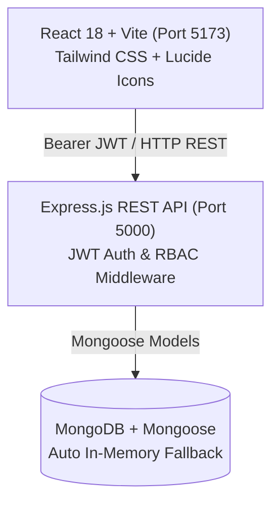

# 🏛️ CampusCare – Smart Campus Complaint Management System

> **Modern, full-stack, hackathon-ready campus infrastructure complaint triage and resolution ecosystem.**  
> Built with **React 18 + Vite**, **Tailwind CSS**, **Node.js + Express**, and **MongoDB + Mongoose**.

---

## ✨ Features & Highlights

### 🎨 1. Modern SaaS UI / UX Design
- **Color Palette**: Deep navy (`#070C18`, `#0B1120`), electric blue (`#3B82F6`), glowing cyan accents, and glassmorphic translucent panels.
- **Micro-Animations & Visual Feedback**: Status dots with pulse/ping animations, hover lift effects, glass borders, and smooth transitions.
- **Responsive Navigation**: Collapsible sidebar, breadcrumbs, live API connection indicator, and instant demo role switcher.
- **Comprehensive Feedback**: Toast notifications, empty state illustrations, loading spinners, and confirm dialogs.

### 👥 2. Role-Based Portals (Students & Campus Admins)

#### 🎓 Student Portal:
- **Overview Dashboard**: Real-time KPI statistics (Total, Pending, In-Progress, Resolved).
- **Submit Complaint Form**:
  - Six categories: **Electricity**, **Wi-Fi**, **Cleanliness**, **Water**, **Furniture**, and **Other**.
  - Priority selection (Low, Medium, High, Critical).
  - Exact Location / Building / Room number with quick-fill presets.
  - Image upload with drag & drop, file preview, or 1-click sample campus photo picker.
- **My Complaints Tracker**:
  - Toggle between **Card Grid view** and **Dense Table view**.
  - Search by complaint ID, title, or location.
  - Filter tabs by status and category dropdown.
  - Interactive **Status Timeline** tracking every admin review, department assignment, and repair step.
  - Ability to cancel/delete pending complaints.

#### 🛡️ Administrator Command Hub:
- **Campus-Wide KPI Metrics**: Total complaints, pending review queue, active field dispatches, and resolution percentage.
- **Visual Analytics**: Interactive complaints-by-category distribution bars and departmental workload allocation.
- **Direct Triage Matrix**:
  - Inline one-click status transitions (**Pending** ➔ **In Progress** ➔ **Resolved** / **Rejected**).
  - Assign to departments (**Electrical**, **IT & Networking**, **Sanitation & Housekeeping**, **Plumbing & Facilities**, **Carpentry & Maintenance**, **General Administration**).
  - Add internal administrative resolution notes and student-visible timeline progress updates.
  - Full inspection drawer with photo evidence lightbox.

---

## ⚡ Instant Demo Credentials

For hackathon judges and evaluators, the login screen includes **1-Click Demo Login** buttons:

| Role | Email | Password | Access Level |
| :--- | :--- | :--- | :--- |
| **Campus Admin** | `admin@campuscare.edu` | `admin123` | Full campus triage, department assignment & status updates |
| **Demo Student** | `student@campuscare.edu` | `student123` | Create complaints, track timeline & view personal history |
| **Second Student** | `priya@campuscare.edu` | `student123` | Multi-user isolation verification |

---

## 🏗️ Architecture & Tech Stack



- **Frontend**: React 18, Vite, Tailwind CSS, Lucide React icons.
- **Backend**: Node.js, Express.js, JSON Web Tokens (JWT), bcrypt.js password hashing, Morgan logging.
- **Database**: MongoDB with Mongoose ODM.
  - *Smart Fallback*: Automatically detects local MongoDB (`mongodb://localhost:27017/campuscare`). If MongoDB is not pre-installed or running, it seamlessly launches `mongodb-memory-server` zero-config in-memory database with pre-seeded demo records!

---

## 📁 Project Structure

```text
test/
├── backend/
│   ├── src/
│   │   ├── config/
│   │   │   └── db.js            # MongoDB connection with in-memory fallback & auto-seeding
│   │   ├── controllers/
│   │   │   ├── authController.js       # Register, Login, GetMe
│   │   │   └── complaintController.js  # CRUD, Status update, Analytics, Timelines
│   │   ├── middleware/
│   │   │   ├── authMiddleware.js       # JWT & Admin RBAC verification
│   │   │   └── errorMiddleware.js      # 404 & Centralized Error Handler
│   │   ├── models/
│   │   │   ├── User.js                 # User schema with bcrypt hash hook
│   │   │   └── Complaint.js            # Complaint schema with timeline array
│   │   ├── routes/
│   │   │   ├── authRoutes.js
│   │   │   └── complaintRoutes.js
│   │   ├── utils/
│   │   │   ├── generateId.js           # Sequential CC-YYYY-XXXX generator
│   │   │   └── seedData.js             # Realistic demo users & tickets seed
│   │   └── server.js                   # Express application entrypoint
│   ├── .env
│   ├── .env.example
│   ├── package.json
│   └── test-e2e.js                     # Automated API verification suite
├── frontend/
│   ├── src/
│   │   ├── components/
│   │   │   ├── Navbar.jsx              # Responsive header with demo role switcher
│   │   │   ├── Sidebar.jsx             # SaaS collapsible navigation
│   │   │   ├── StatCard.jsx            # Glassmorphism metric cards
│   │   │   ├── ComplaintCard.jsx       # Grid ticket card with badges
│   │   │   ├── ComplaintModal.jsx      # Detail drawer with photo & admin controls
│   │   │   ├── TimelineView.jsx        # Vertical status history timeline
│   │   │   ├── StatusBadge.jsx         # Animated status indicators
│   │   │   ├── PriorityBadge.jsx       # Priority pills
│   │   │   ├── CategoryBadge.jsx       # Category icons & badges
│   │   │   └── Toast.jsx               # Floating toast notifications
│   │   ├── context/
│   │   │   └── AuthContext.jsx         # Global auth state & demo login
│   │   ├── pages/
│   │   │   ├── AuthPage.jsx            # Login & Registration with demo pills
│   │   │   ├── StudentDashboard.jsx    # Student KPI overview & recent tickets
│   │   │   ├── SubmitComplaint.jsx     # Full submission form with image upload
│   │   │   ├── MyComplaints.jsx        # Personal complaints table & grid
│   │   │   └── AdminDashboard.jsx      # Admin dispatch & campus analytics
│   │   ├── services/
│   │   │   └── api.js                  # Centralized REST client
│   │   ├── App.jsx
│   │   ├── index.css
│   │   └── main.jsx
│   ├── .env
│   ├── .env.example
│   ├── tailwind.config.js
│   ├── vite.config.js
│   └── package.json
├── package.json
└── README.md
```

---

## 🚀 Getting Started

### Prerequisites
- **Node.js** (v18 or higher recommended)
- **npm** (v9 or higher)

### 1. Installation
Run from root or separately in `backend` and `frontend`:

```bash
# In backend
cd backend
npm install

# In frontend
cd ../frontend
npm install
```

### 2. Configure Environment Variables
Default files are already pre-configured. If required:

**`backend/.env`**:
```env
PORT=5000
MONGODB_URI=mongodb://localhost:27017/campuscare
JWT_SECRET=supersecretcampuscarekey2026_jwt_token!
NODE_ENV=development
```

**`frontend/.env`**:
```env
VITE_API_BASE_URL=http://localhost:5000/api
```

### 3. Run the Backend Server
```bash
cd backend
npm run dev
```
> The server will start on `http://localhost:5000`. If local MongoDB is running, it connects immediately. If not, it boots an in-memory database with pre-loaded demo tickets!

### 4. Run Locally (Full Stack in 1 Command)
```bash
npm run dev
```
> Starts both backend (http://localhost:5000) and frontend (http://localhost:5173) concurrently.

---

## ⚡ Deploying on Vercel

CampusCare is fully optimized for **Vercel** with two flexible deployment paths:

### Option A: 1-Click Unified Monorepo (Frontend + Serverless API)
1. Push your repository to GitHub.
2. Go to [vercel.com](https://vercel.com) and click **"Add New Project"** ➔ **Import Git Repository**.
3. Keep **Root Directory** as `./` (default).
4. Vercel automatically detects the root `vercel.json`:
   - Builds frontend with `npm --prefix frontend run build` to `frontend/dist`.
   - Deploys Express API as Serverless Functions via `api/index.js` handling `/api/*`.
5. Under **Environment Variables**, add:
   - `MONGODB_URI`: Your MongoDB Atlas connection URI (`mongodb+srv://...`).
   - `JWT_SECRET`: Any secure random secret (e.g. `supersecretcampuscarekey2026_jwt_token!`).
   - `NODE_ENV`: `production`
6. Click **Deploy**!

### Option B: Deploy Frontend on Vercel (with external Backend on Render/Railway)
1. Import repository on Vercel.
2. Select **Root Directory**: `frontend`.
3. Framework preset will automatically be set to **Vite**.
4. Under **Environment Variables**, add:
   - `VITE_API_BASE_URL`: `https://your-backend-service.onrender.com/api`
5. Click **Deploy**! (The bundled `frontend/vercel.json` ensures full SPA client-side routing support).

---

## 🧪 Testing the Application

An automated 9-point end-to-end test script is included:

```bash
node backend/test-e2e.js
```

**Verified Test Scenarios:**
1. Health check `/api/health` ➔ `200 OK`
2. Student login with bcrypt validation ➔ `200 OK`
3. Student KPI analytics aggregation ➔ `200 OK`
4. Complaint ticket creation (`CC-2026-XXXX`) with timeline event ➔ `201 Created`
5. Verification in student ticket directory ➔ `200 OK`
6. Admin authentication and privilege escalation check ➔ `200 OK`
7. Admin campus-wide directory and department statistics ➔ `200 OK`
8. Status update to `In Progress` + department assignment to `IT & Networking` ➔ `200 OK`
9. Student cross-verification of updated timeline & assigned staff ➔ `200 OK`

---

## 📡 REST API Reference

| Method | Endpoint | Access | Description |
| :--- | :--- | :--- | :--- |
| `POST` | `/api/auth/register` | Public | Register new student or admin account |
| `POST` | `/api/auth/login` | Public | Authenticate user & return JWT |
| `GET` | `/api/auth/me` | Authenticated | Retrieve authenticated user profile |
| `GET` | `/api/complaints/analytics` | Authenticated | Aggregated status, category, & department metrics |
| `POST` | `/api/complaints` | Authenticated | Submit a new complaint with image & location |
| `GET` | `/api/complaints/my` | Authenticated | Fetch current user's submitted complaints |
| `GET` | `/api/complaints/all` | Admin Only | Fetch all campus complaints with filters |
| `GET` | `/api/complaints/:id` | Authenticated | Get single complaint with full timeline |
| `PATCH`| `/api/complaints/:id/status`| Admin Only | Update status, assign department & record timeline note |
| `DELETE`| `/api/complaints/:id` | Owner / Admin | Delete pending complaint |

---

## 🏆 Hackathon Notes
- Zero dummy buttons: every toggle, dropdown, card, and modal is connected to live MongoDB and Express endpoints.
- Base64 and remote URL image support ensures image upload works without external AWS S3 dependencies.
- Built with high responsiveness across desktop, tablet, and mobile screens.
"# CampusCare" 
